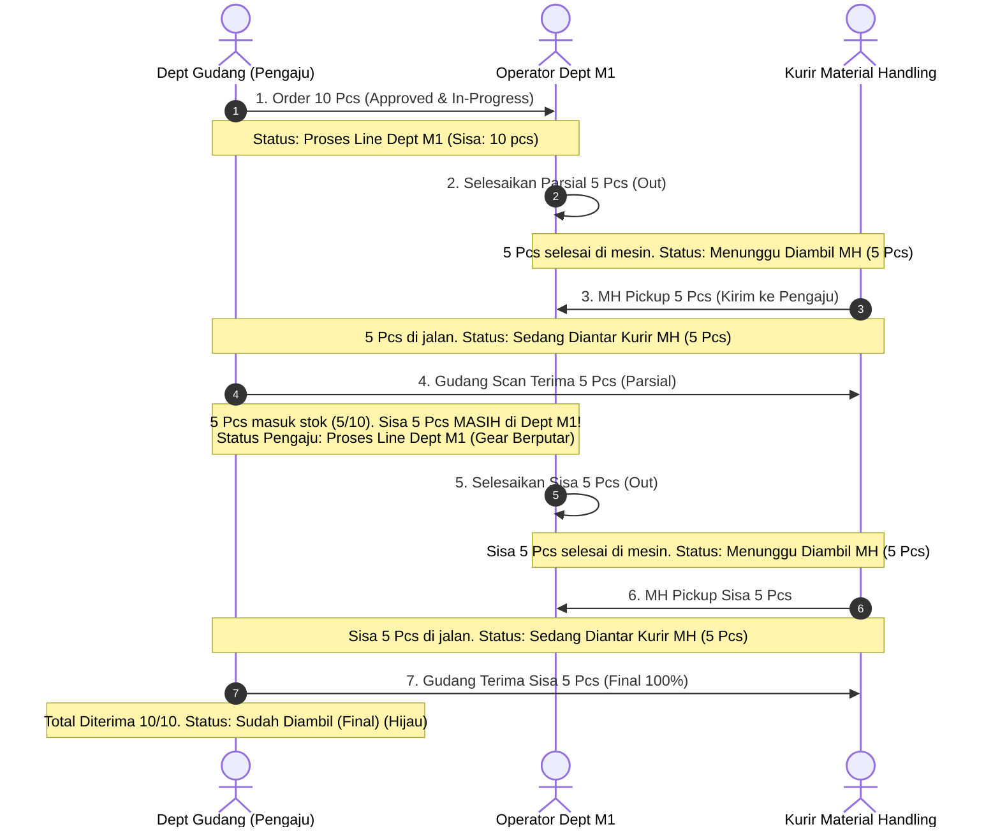

# ATURAN MUTLAK SISTEM: STATUS, SALDO & ALUR PENGERJAAN PARSIAL WORK REQUEST (WRI)

Dokumen ini adalah **pedoman resmi dan aturan baku mutlak (Single Source of Truth)** untuk arsitektur *State Machine*, kalkulasi saldo fisik, dan penampilan status Work Request (WRI) pada sistem HPK Gudang Inhouse ketika terjadi **pengerjaan dan pengiriman bertahap (parsial/cicilan)**.

Dokumen ini merupakan **addendum teknis spesialis** yang terikat langsung dan memperkuat aturan bisnis **BR-07** pada buku manual induk [docs/SOP_DAN_ALUR_PROSES.md](SOP_DAN_ALUR_PROSES.md). Seluruh definisi, terminologi, dan alur di sini berpadu selaras 100% tanpa pertentangan dengan SOP Induk.

Dokumen ini wajib dijadikan acuan mutlak bagi seluruh pengembang (*developer*), AI Agent, dan *user* agar logika sistem tidak berubah-ubah atau mengalami regresi di kemudian hari.

---

## 1. Tiga Perspektif Terpisah dalam Sistem WRI

Salah satu penyebab utama *bug* tampilan adalah pencampuran antara aksi operator dengan status global tiket. Sistem membedakan secara tegas 3 perspektif berikut:

| No | Perspektif | Komponen Penentu | Deskripsi & Contoh |
| :--- | :--- | :--- | :--- |
| **1** | **Status Fisik Bahan** (*Material State*) | Posisi fisik riil material di lantai pabrik | Apakah barang sedang diproses di mesin (`saldo_out > 0`), sedang berada di palet tunggu jemputan (`waiting_pickup > 0`), sedang di troli kurir MH (`in_transit > 0`), atau sudah di rak gudang (`quantity_received`). |
| **2** | **Aksi Interaktif Aktor** (*Actor Action Button*) | Tombol aksi yang dapat diklik oleh pengguna sesuai peran & otorisasi | Tombol **`Selesai: Siap Diambil`** untuk operator mesin M1 saat menyelesaikan proses Out, tombol **`MH Pickup`** untuk kurir MH, atau tombol **`Scan Diterima`** untuk gudang. |
| **3** | **Tampilan Monitoring Pengaju** (*Requester View Badge*) | Label status dan lencana yang dilihat oleh pengaju/gudang dan publik | Jika belum ada barang fisik yang menunggu kurir MH, pengaju **WAJIB** melihat status stasiun kerja yang sedang aktif memproses barang (**`Proses Line Dept {Mesin}`**), **BUKAN** lencana prematur `Menunggu Diambil MH`. |

---

## 2. Matriks 7 Fase Siklus Hidup Parsial (Studi Kasus 10 Pcs)

Sebagai contoh kasus operasional: **Gudang memesan 10 pcs ke Dept Pemesinan (M1)**, lalu M1 mengerjakan cicilan **5 pcs terlebih dahulu**, diserahterimakan ke gudang, baru kemudian menyelesaikan **5 pcs sisanya**.



### Tabel Rincian Status Tiap Fase

| Fase | Kondisi Fisik | Saldo M1 (`Out`) | Saldo Jemput MH (`waiting_pickup`) | Saldo Kurir MH (`in_transit`) | Diterima Gudang | Tampilan Sisi Pengaju (Gudang) | Tombol Aksi Sisi Mesin (M1) |
| :---: | :--- | :---: | :---: | :---: | :---: | :--- | :--- |
| **1** | M1 memulai pengerjaan 10 pcs | 10 | 0 | 0 | 0 / 10 | `<i class="fa-gear fa-spin"></i> Proses Line Dept M1` | `Selesai: Siap Diambil` (Qty: 10) |
| **2** | M1 menyelesaikan 5 pcs (Out) | 5 | **5** | 0 | 0 / 10 | `Menunggu Diambil MH` + `[Buka Menu MH]` | `Selesai: Siap Diambil` (Qty: 5) |
| **3** | Kurir MH menjemput 5 pcs | 5 | 0 | **5** | 0 / 10 | `Sedang Diantar Kurir MH` | `Selesai: Siap Diambil` (Qty: 5) |
| **4** | **Gudang menerima 5 pcs** *(Kasus Isu)* | **5** | **0** | **0** | **5 / 10** | `<i class="fa-gear fa-spin"></i> Proses Line Dept M1` | `Selesai: Siap Diambil` (Qty: 5) |
| **5** | M1 menyelesaikan sisa 5 pcs | 0 | **5** | 0 | 5 / 10 | `Menunggu Diambil MH` + `[Buka Menu MH]` | *(Tidak ada aksi mesin)* |
| **6** | Kurir MH menjemput sisa 5 pcs | 0 | 0 | **5** | 5 / 10 | `Sedang Diantar Kurir MH` | *(Tidak ada aksi)* |
| **7** | Gudang menerima sisa 5 pcs (Tuntas) | 0 | 0 | 0 | **10 / 10** | `Sudah Diambil (Final)` (Hijau) | *(Selesai Tuntas - Closed)* |

> [!IMPORTANT]
> **Poin Utama (Fase 4):**
> Ketika Gudang baru menerima 5 pcs dari total 10 pcs, tiket **TIDAK BOLEH** menampilkan lencana `Menunggu Diambil MH` ataupun tombol `[Buka Menu MH]`. Hal ini karena di stasiun mesin M1 **TIDAK ADA** barang jadi yang sedang menunggu kurir (`waiting_pickup = 0`). Sisa 5 pcs masih berupa bahan dalam proses pengerjaan mesin M1 (`saldo_out = 5`). Maka status yang benar adalah **`Proses Line Dept M1`**.

---

## 3. Rumus Baku Saldo Sistem Backend (`app/Models/WorkRequest.php`)

Perhitungan saldo per tahapan proses mengikuti rumus matematika berikut:

### A. Saldo Langkah Mesin (`getStepBalance($stepName, $stepIndex)`)
1. **Total In:** Kuantitas yang telah diproses masuk ke stasiun mesin.
   $$\text{total\_in} = \sum \text{Qty}(\text{Proses: } stepName \text{ (In)})$$
2. **Total Out:** Kuantitas yang telah selesai dikerjakan mesin.
   $$\text{total\_out} = \begin{cases} 
   \sum \text{Qty}(\text{Siap Diambil}) \text{ atau } \sum \text{Qty}(\text{Proses: } stepName \text{ (Out)}) & \text{jika } isLastStep \\
   \sum \text{Qty}(\text{Proses: } stepName \text{ (Out)}) & \text{jika bukan } isLastStep
   \end{cases}$$
3. **Total Pickup (Aturan Khusus Langkah Akhir):**
   Pada tahapan akhir (*last step*), kurir MH mencatat penjemputan dengan status `Menuju Pengaju`. Oleh karena itu:
   $$\text{total\_pickup} = \begin{cases} 
   \max(\sum \text{Qty}(\text{Menuju Pengaju}), \sum \text{Qty}(\text{MH Pickup: } stepName)) & \text{jika } isLastStep \\
   \sum \text{Qty}(\text{MH Pickup: } stepName) & \text{jika bukan } isLastStep
   \end{cases}$$
4. **Saldo Belum Selesai Mesin (`saldo_out`):**
   $$\text{saldo\_out} = \max(0, \min(\text{total\_in} - \text{total\_out} - \text{defects}, \text{totalReq} - \text{total\_out}))$$
5. **Saldo Menunggu Jemputan MH (`waiting_pickup`):**
   $$\text{waiting\_pickup} = \max(0, \min(\text{total\_out} - \text{total\_pickup} - \text{pickupDefects}, \text{totalReq} - \text{total\_pickup}))$$

### B. Helper Ketersediaan Saldo Fisik Riil
Sistem menyediakan method resmi pada model `WorkRequest`:
- `hasPhysicalWaitingPickup(): bool`: Bernilai `true` **HANYA JIKA** ada salah satu tahapan mesin yang memiliki $\text{waiting\_pickup} > 0$.
- `getInTransitQuantity(): float`: Menghitung kuantitas yang sedang dibawa kurir MH menuju pengaju:
  $$\text{in\_transit} = \max(0, \sum \text{Qty}(\text{Menuju Pengaju}) - \text{quantity\_received})$$
- `getInterStepTransitTarget(): ?string`: Memeriksa transit kurir MH **antar-mesin** pada alur multi-tahap (misal: `Dept M1 -> Dept Laser Cutting`). Jika `total_pickup` (`MH Pickup: Step N`) lebih besar daripada `total_in` tahap berikutnya (`Step N+1`), mengembalikan nama departemen tujuan (`Dept Laser Cutting`).

---

## 4. Standar Penentuan Status Tiket Global (`getNextStatusLabel`)

Ketika sistem menentukan label status berikutnya untuk publik/pengaju yang tidak memiliki hak aksi eksekusi pada tiket:
1. Jika tiket belum final (`!$this->is_final`):
   - Jika ada $\text{saldo\_in} > 0$, status adalah pengerjaan masuk: **`Proses: {$step} (In)`**.
   - Jika ada $\text{saldo\_out} > 0$, mesin sedang mengerjakan: **`Proses: {$step} (Out)`** (*DILARANG mengembalikan 'Siap Diambil'*).
   - Jika ada $\text{waiting\_pickup} > 0$, barang menunggu kurir MH: **`Menuju Pengaju`** (langkah akhir) atau **`MH Pickup: {$step}`**.
   - Jika ada barang dalam perjalanan kurir ($\text{totalMenuju} > \text{totalSudah}$): **`Sudah Diambil`** (menunggu verifikasi penerimaan gudang).

---

## 5. Logika Tampilan Tabel Antrean (`resources/views/work_requests/partials/_table_content.blade.php`)

Pengecekan lencana status antrean tidak boleh hanya mengandalkan pencocokan *string* status sebelumnya, melainkan wajib mengevaluasi ketersediaan saldo fisik:

```php
// Evaluasi Saldo Fisik Riil & Transit Antar-Mesin
$hasWaitingPickup = $wri->hasPhysicalWaitingPickup();
$inTransitQty = $wri->getInTransitQuantity();
$interStepTarget = $wri->getInterStepTransitTarget();

$isWaitingMH = !$wri->is_final && (
    $hasWaitingPickup ||
    ($wri->steps->isEmpty() && (in_array($cleanStatus, ['siap diambil', 'ready_for_warehouse']) || str_ends_with($cleanStatus, '(out)')))
);
$isInterStepTransit = !$wri->is_final && !$isWaitingMH && !empty($interStepTarget);
$isInTransitMH = !$wri->is_final && !$isWaitingMH && !$isInterStepTransit && (str_contains($cleanStatus, 'menuju pengaju') || $inTransitQty > 0);
$isReceivedGudang = $wri->is_final && (str_contains($cleanStatus, 'sudah diambil') || $cleanStatus === 'received');
```

Hierarki tampilan saat pengguna tidak memiliki aksi eksekusi langsung:
1. `@if($isWaitingMH)` $\rightarrow$ Lencana **Menunggu Diambil MH** + Tombol **`[Buka Menu MH]`**
2. `@elseif($isInterStepTransit)` $\rightarrow$ Lencana **Diantar MH ke {Nama Dept Tujuan}** + Tombol **`[Pantau di MH]`** *(Status `MH Pickup: Step N` tidak boleh lagi tampil `Menunggu Diambil MH`)*
3. `@elseif($isInTransitMH)` $\rightarrow$ Lencana **Sedang Diantar Kurir MH** + Tombol **`[Pantau di MH]`**
4. `@elseif($isReceivedGudang)` $\rightarrow$ Lencana **Tunggu Terima Gudang**
5. `@else` $\rightarrow$ Lencana **Proses Line {Nama Dept Aktif}** (dengan ikon *gear spin*)

---

## 6. Aturan Mutlak Multi-Routing & Otorisasi Per Tahapan

1. **Otorisasi Terisolasi per Tahapan (`canUserProcessAction` & `getAvailableActionsForUser`):**
   - Operator atau Kepala Departemen pada Tahap 1 (misal `Dept M1`) **DILARANG** memproses Tahap 2 (`Dept Laser Cutting`), meskipun `assigned_operator_name` tiket tercatat atas nama operator Tahap 1.
   - Sebaliknya, akun Departemen Tahap 2 (`Dept Laser Cutting`) **WAJIB** diizinkan memproses tahapan miliknya setelah barang diantar MH (`MH Pickup: Dept M1`), dan log aksi wajib mencatat nama operator Tahap 2 tersebut (bukan mewarisi nama operator Tahap 1).
2. **Tampilan Kolom Routing Lengkap di Tabel:**
   - Kolom `Routing` pada tabel antrean **WAJIB** menampilkan urutan penuh seluruh tahapan departemen (`implode(' → ', $wri->getRoutingStepsList())`, misal: `Dept M1 → Dept Laser Cutting`), tidak boleh hanya menampilkan `dept_penerima` tahap pertama.

---

## 7. Guardrail Pencegahan Regresi (Anti-Regression Checklist)

Setiap pengembang atau AI Agent yang melakukan perubahan di masa mendatang **WAJIB** mematuhi aturan berikut:
1. **Dilarang Menimpa Total Pickup Langkah Terakhir:** Jangan pernah menghapus pembacaan status `Menuju Pengaju` dari kalkulasi `$totalPickup` di `getStepBalance`.
2. **Dilarang Mengembalikan 'Siap Diambil' di `getNextStatusLabel` saat `saldo_out > 0`:** Mengembalikan 'Siap Diambil' saat mesin masih bekerja akan merusak tampilan sisi pengaju seolah-olah barang sudah selesai.
3. **Dilarang Memukul Rata Status `MH Pickup` sebagai `Menunggu Diambil MH`:** Status `MH Pickup: Step N` artinya kurir MH sudah mengambil barang dan sedang mengantar ke `Step N+1`.
4. **Pemberian Tombol Eksekusi Tetap Presisi:** Tombol aksi operator mesin (seperti `Selesai: Siap Diambil` dengan kuantitas parsial sisa, atau `Mulai: Proses: Step N+1 (In)`) tetap mutlak disediakan hanya untuk peran departemen tahapan aktif bersangkutan.
