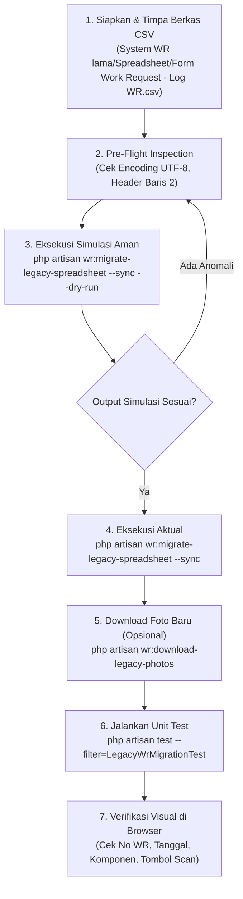

# Buku Panduan Resmi & Catatan Migrasi Data: Log WR Spreadsheet ke HPK WMS

Dokumen ini adalah catatan teknis resmi dan panduan pemeliharaan permanen mengenai proses migrasi data dari sistem lama berbasis **Google Spreadsheet (`System WR lama/Spreadsheet/Form Work Request - Log WR.csv`)** ke dalam database relasional **HPK WMS (Laravel 10 + MySQL)**.

Setiap developer, staf IT, maupun AI Agent CLI di masa mendatang **WAJIB membaca dokumen ini** sebelum melakukan sinkronisasi atau perubahan data Work Request lama.

---

## 1. Latar Belakang & Sumber Data

- **Sumber Data Asli:**
  1. `System WR lama/Spreadsheet/Form Work Request - Log WR.csv` (822 baris data transaksi WRI historis).
  2. `System WR lama/Spreadsheet/Form Work Request - Komponen baru.csv` (119 baris pendaftaran komponen non-katalog).
  3. `System WR lama/Spreadsheet/Form Work Request - ID_Routing.csv` (12 routing departemen pengerjaan).
- **Tujuan Migrasi:**
  1. Menyelamatkan seluruh arsip historis permohonan pengerjaan dan log audit pengerjaan mesin.
  2. Mengaktifkan kembali **159 tiket berjalan (*in-progress*)** yang belum selesai di spreadsheet agar dapat dilanjutkan proses fisiknya melalui stasiun mesin dan modul Material Handling di sistem baru.
  3. Mengunduh 491 berkas foto fisik dari Google Drive ke server master lokal On-Premise NAS (`Z:\...` / `uploads/components/`).
  4. Menjaga integritas inventori gudang dengan **Nol Perubahan Stok (*Zero Stock Disturbance*)**.

---

## 2. Standardisasi Format Nomor WR (6-Segmen)

Format nomor dokumen WR yang dibakukan dan diselaraskan:
$$\text{WR} \;/\; \{\text{Dept Pengaju}\} \;/\; \{\text{YYYYMMDD}\} \;/\; \{\text{Urutan WR Harian}\} \;/\; \{\text{Kode Part / "Baru"}\} \;/\; \{\text{Urutan Item Harian}\}$$

### Contoh Riil:
- **Komponen Master Terdaftar:**
  `WR/Dept Gudang/20260608/1/CFPP10100100031W/1`
- **Komponen Belum Terdaftar (Baru):**
  `WR/Dept Gudang/20260611/2/Baru/1`

### Aturan Identitas `"Baru"`:
- Pada nomor dokumen fisik WR (surat jalan, antrean mesin, label cetak), slot ke-5 **tetap tercetak literal `"Baru"`**.
- Di balik layar database, tabel `components` membuatkan rekaman master sementara dengan kode: **`NEW-{YYYYMMDD}-{Seq}`** (contoh: `NEW-20260611-001`) dan status `pending_catalog` agar relasi foreign key `work_requests.component_id` tetap valid 100%.

---

## 3. Protokol Auto-Download Foto Google Drive ke NAS

- **Total Berkas Foto Unik:** Terdapat **491 foto unik** di Google Drive lama.
- **Format Penamaan File Foto di NAS:**
  1. *Komponen Resmi (331 part):* Disimpan dengan nama kode part resminya: **`[part_number].jpg`** (contoh: `CFPP10100100031W.jpg`).
  2. *Komponen Baru (209 foto):* Disimpan dengan nama kode part sementaranya: **`NEW-{YYYYMMDD}-{Seq}.jpg`** (contoh: `NEW-20260617-001.jpg`).
- **Lokasi Penyimpanan Ganda:**
  - **Master Storage:** Drive NAS `Z:\08.Project\04. HPK Digitalisasi Program\04. Gudang-Komponen\Komonpen Gudang In House` (fallback cadangan: `D:\Ali Magang\KOMPONEN`).
  - **Web Mirror:** `public/uploads/components/` (untuk akses HTTP cepat stasiun mesin).
- **Penanganan Gambar Gagal / Privat:**
  Jika link Google Drive mati (404/403), script memasang fallback ke `images/placeholder_part.svg` tanpa membatalkan pembuatan tiket WR.

---

## 4. Jaminan Nol Perubahan Stok (Zero Stock Disturbance Protocol)

> [!CAUTION]
> **ATURAN MUTLAK:** Migrasi data WRI lama adalah perpindahan data job order administratif dan jejak pengerjaan mesin, **BUKAN TRANSAKSI MUTASI INVENTORI GUDANG**.

1. **Isolasi Mutlak Tabel Stok:**
   - Script migrasi **DILARANG KERAS** menambah baris ke tabel `transactions` (`inbound`, `outbound`, `transfer`).
   - Nilai kolom `components.total_stock` **TIDAK BOLEH BERUBAH 1 PCS PUN**.
2. **Flag Data Migrasi (`is_legacy`):**
   - Seluruh tiket yang berasal dari migrasi spreadsheet ditandai dengan flag `is_legacy = true`.
   - Ketika 159 tiket in-progress kelak diselesaikan di sistem baru, sistem menyediakan validasi apakah mutasi fisik barang sudah dihitung di masa lalu atau hanya penyelesaian status administratif.

---

## 5. Protokol Anti-Duplikasi (Idempotensi Penuh)

Proses migrasi dapat dijalankan berulang kali secara aman (*safe & idempotent*):
1. **Idempotensi File Foto:** Sistem memeriksa apakah file `[part_number].[ext]` sudah ada di NAS atau folder mirror. Jika file sudah ada (> 100 bytes), unduhan **otomatis dilewati (*SKIP*)**.
2. **Idempotensi Komponen "Baru":** Jika nama barang dan spesifikasi dimensi sama persis dengan baris sebelumnya (contoh: *"sirip plangkon d7"* yang muncul 3 kali di spreadsheet), sistem **menggunakan kembali `component_id` yang sudah ada (*REUSE*)**, mencegah master part ganda.
3. **Idempotensi Tiket WR:** Sebelum insert, sistem mengecek kolom `wri_number`. Jika tiket sudah pernah diimpor, baris tersebut **otomatis dilewati (*SKIP*)**.

---

## 6. Kelanjutan 159 Tiket Belum Selesai (In-Progress)

Dari 820 baris data spreadsheet, 661 tiket sudah berstatus `Sudah diambil` (selesai penuh sebagai arsip). Sedangkan **159 tiket in-progress** langsung aktif di sistem baru:

| Status Asli di Spreadsheet | Qty Tiket | Mapping Status di HPK WMS Baru | Modul & Aksi Lanjutan di Sistem Baru |
| :--- | :---: | :--- | :--- |
| **`Belum Verifikasi`** | 90 | `status: 'submitted'`<br>`approval_pengaju: 'Menunggu'` | Tab **Antrean WRI**. Kepala Bagian Pengaju/Penerima dapat langsung klik **[Terima]** / **[Tolak]**. |
| **`Dalam antrian`** | 42 | `status: 'Dalam antrian'`<br>`approval: 'Diterima'` | Dashboard stasiun mesin tujuan (Laser, M1, UNP, dll.). Operator mesin dapat klik **[Mulai Proses Mesin]**. |
| **`Proses: Dept ... (In)`** | 7 | `status: 'Proses: Dept ... (In)'`<br>`current_process_status: 'Proses In'` | Antrean aktif mesin. Operator mesin dapat klik **[Proses Selesai]** atau **[Parsial]**. |
| **`Siap diambil`** | 18 | `status: 'Siap diambil'`<br>`current_process_status: 'Siap diambil'` | Modul **Material Handling (MH)** tab *Tugas Penjemputan (Pickup)*. Kurir MH dapat scan/ambil barang. |
| **`Menuju Pengaju`** | 2 | `status: 'Menuju Pengaju'`<br>`current_process_status: 'Menuju Pengaju'` | Modul **Material Handling** tab *Menuju Pengaju* dan POV Pengaju untuk konfirmasi **[Sudah Diambil]**. |

### Syarat Teknis yang Dipenuhi:
- Setiap tiket dibuatkan relasi ke tabel `work_request_steps` yang menunjuk ke ID mesin yang tepat.
- Kuantitas yang sudah diambil (`quantity_received`) dan siap diambil (`quantity_produced`) dihitung presisi dari teks log kolom `Data Proses`.

---

## 7. Perintah Eksekusi (Artisan Commands)

Dua perintah CLI Laravel yang disediakan:

### 1. Unduh Seluruh Foto ke NAS & Mirror
```bash
# Unduh seluruh foto unik Google Drive ke NAS dan uploads/components
php artisan wr:download-legacy-photos
```

### 2. Migrasi Data Log WR ke Database
```bash
# 1. Uji coba simulasi (Tanpa Menulis ke Database)
php artisan wr:migrate-legacy-spreadsheet --dry-run

# 2. Eksekusi riil pemindahan data dengan sinkronisasi tiket eksis
php artisan wr:migrate-legacy-spreadsheet --sync

# 3. Uji coba simulasi dengan opsi sinkronisasi
php artisan wr:migrate-legacy-spreadsheet --sync --dry-run

# 4. Eksekusi khusus hanya tiket in-progress (opsional)
php artisan wr:migrate-legacy-spreadsheet --only-in-progress
```

---

## 8. Panduan untuk AI Agent & Pengembang Selanjutnya

Jika di masa mendatang pengguna ingin melakukan migrasi tambahan dari file spreadsheet baru:
1. **Periksa Status Eksisting:** Jalankan `WorkRequest::where('wri_number', 'like', 'WR/%')->count()` untuk melihat jumlah tiket migrasi yang sudah ada.
2. **Gunakan Mode `--sync`:** Ketika file CSV diperbarui dengan data transaksi yang telah berjalan di pabrik, gunakan flag `--sync` agar tiket yang tadinya berstatus `in_progress` dapat dimutakhirkan ke `is_final = 1` tanpa menduplikasi data (UPSERT).
3. **Pertahankan Zero Stock:** Jangan pernah menambahkan trigger mutasi stok pada data migrasi spreadsheet.
4. **Patuhi Idempotensi:** Selalu gunakan pencocokan `wri_number` sebelum insert.
5. **Sinkronisasi Dokumentasi:** Selalu perbarui berkas ini jika terdapat perubahan skema atau penambahan fitur baru pada modul Work Request.

---

## 9. Resolusi Hierarki Approval & Koreksi Tiket Ditolak

Pada evaluasi pasca-migrasi, ditemukan bahwa 15 tiket spreadsheet yang memiliki status penolakan (`approval_pengaju = 'Ditolak'` atau `approval_penerima = 'Ditolak'`) sebelumnya masih tercatat dengan `status = 'Belum Verifikasi'` dan `approval_penerima = 'Menunggu'`.

Hal ini telah diselesaikan dengan tata kelola baku:
1. **Ka. Pengaju Rejection Hard Stop:** Tiket yang ditolak di tingkat pengaju otomatis membatalkan alur ke penerima (`approval_penerima = 'Ditolak'`, `status = 'cancelled'`, `is_final = true`).
2. **Partisi Mutually Exclusive:** Kartu *Perlu Verifikasi* murni menyaring tiket yang sah membutuhkan approval, sedangkan tiket yang tertolak dikarantina penuh di kartu *Ditolak / Batal*.
3. **Penyempurnaan UI:** Lencana bawah No WR menampilkan `✕ Ditolak Pengaju` atau `✕ Ditolak Penerima`, dan kolom status penerima menampilkan `Batal`.

---

## 10. Pembaruan Migrasi 841 Baris & Smart Sync (17 November 2026)

Pada tanggal 17 November 2026, berkas `Form Work Request - Log WR.csv` dimutakhirkan dengan data operasional riil hingga tanggal 17 November 2026 (total 841 baris valid):
1. **Penyelesaian 44 Tiket Menggantung:** Sebanyak 44 tiket yang sebelumnya tertahan di status `Proses: Dept ... (In)` dan `Dalam antrian` berhasil disinkronkan menjadi `Sudah Diambil` (`is_final = 1`) berdasarkan catatan log pengambilan riil di pabrik.
2. **Penambahan 451 Tiket Baru:** Tiket baru periode Oktober hingga November 2026 berhasil didaftarkan secara rapi tanpa merusak relasi ataupun data yang sudah ada.
3. **Zero Stock Disturbance:** Kuantitas stok master `components` dan tabel `transactions` tetap 100% terjaga tanpa mutasi fiktif.
4. **Zero Duplikasi:** Total tiket di database bertambah secara eksak menjadi **859 tiket** (390 tiket lama + 18 tiket web internal + 451 tiket baru).

---

## 11. Pembaruan Migrasi 845 Baris & Penyelarasan Tombol Aksi Gudang "Scan Diterima" (18 November 2026)

Pada tanggal 18 November 2026, berkas `Form Work Request - Log WR.csv` kembali dimutakhirkan menjadi 845 baris valid oleh operasional:
1. **Eksekusi Smart Sync 845 Baris:**
   - Dijalankan perintah: `php artisan wr:migrate-legacy-spreadsheet --sync`.
   - Hasil: 845 baris diproses, 4 tiket baru didaftarkan, 6 tiket aktif dimutakhirkan, 0 tiket terduplikasi.
2. **Koreksi Diskrepansi UI "Menunggu Penerima" vs "Scan Diterima":**
   - **Akar Masalah:** Pada sistem lama Google Spreadsheet/Apps Script, operator di lini pabrik langsung memindai QR code untuk proses pengerjaan (`Proses In` -> `Siap diambil`) tanpa melalui langkah verifikasi tertulis kepala bagian, sehingga status fisik barang sudah sampai di `Siap diambil` namun kolom persetujuan penerima di spreadsheet lama kadang tertinggal atau berstatus implisit.
   - Pada program baru sebelumnya, kolom `Aksi Cepat` mengecek `@elseif($wri->approval_penerima === 'Menunggu')` sebelum mengecek ketersediaan aksi operasional, sehingga tiket yang telah selesai difabrikasi di stasiun mesin terkunci menampilkan badge biru `"Menunggu Penerima"`.
   - **Penyelesaian Logika & UI:**
     - Ditambahkan aturan **Implied Approval**: Jika barang sudah mulai diproduksi (`quantity_produced > 0`) atau telah berstatus pengerjaan fisik (`Siap diambil`), sistem menganggap verifikasi penerimaan telah terpenuhi secara operasional sehingga aksi fisik tidak terblokir.
     - Penyelarasan tombol pada view tabel (`_table_content.blade.php`): Ketika status tiket berada di `Siap diambil` pada stasiun mesin akhir, user Gudang (Pengaju) langsung disajikan tombol hijau emerald **`Scan Diterima (X pcs)`** dengan ikon `fa-check-double`.
     - Validasi pemisahan peran: Operator mesin tidak melihat tombol terima barang (pengerjaan mesin sudah tuntas), dan alur departemen tidak tertukar (Pengaju tetap Gudang, Penerima tetap Mesin Center terkait).
3. **Penyelarasan Identitas Komponen Baru (NEW-YYYYMMDD-SEQ):**
   - Segmen ke-6 No WR (`/1`, `/2`) dipetakan secara presisi menjadi kode part unik harian (`NEW-YYYYMMDD-001`, `NEW-YYYYMMDD-002`).
   - Mencegah kolapsnya komponen baru di tanggal yang sama (seperti `Sliding plate B` dan `Sliding A` pada tanggal 17 November 2026 yang sebelumnya sempat tertukar).
   - Sebanyak 86 tiket komponen baru historis berhasil direkonsiliasi nama dan kode part-nya secara tepat tanpa duplikasi.
4. **Sinkronisasi Waktu Proses Aktual & Tanggal Dokumen:**
   - Atribut `created_at` dan `updated_at` didaftarkan resmi pada `$fillable` di model `WorkRequest` dan `WorkRequestLog`.
   - Parser log mengekstrak tanggal dan jam pengerjaan riil dari string `Data Proses` (format `DD/MM HH:mm`, misal `17/11 13:38`) menjadi timestamp absolut `YYYY-MM-DD HH:mm:00`.
   - Tanggal pembuatan tiket WR di antarmuka tabel diselaraskan persis dengan `Tanggal Order` dokumen fisik (`17 Nov 2026`).

---

## 12. Panduan Operasional Resmi: Pemutakhiran CSV & Migrasi Ulang di Masa Depan (Production Cutover & Sync Runbook)

Bagian ini adalah **SOP baku (*Standard Operating Procedure*)** yang **WAJIB diikuti** oleh siapa pun (staf IT, programmer, maupun AI Agent) saat ingin memperbarui data Work Request menggunakan berkas spreadsheet CSV terbaru (misalnya saat sistem siap *Go-Live* / *Cutover*).

### A. Diagram Alur Prosedur Pemutakhiran CSV


### B. Persiapan Berkas & Lokasi Path
1. **Lokasi Berkas Target:**
   Letakkan berkas CSV terbaru di path absolut proyek:
   `System WR lama/Spreadsheet/Form Work Request - Log WR.csv`
2. **Format Berkas yang Valid:**
   - **Encoding:** UTF-8 (atau UTF-8 without BOM).
   - **Delimiter:** Koma (`,`).
   - **Struktur Baris:**
     - Baris 1: Kosong / metadata spreadsheet.
     - Baris 2: Nama-nama header kolom resmi:
       `[1] Tanggal Order, [2] No WR, [3] Kode Komponen, [4] Nama Komponen, [5] Gambar Komponen, [6] Routing, [7] Dimensi, [8] Qty, [9] Dept Pengaju, [10] Dept Penerima, [11] Deskripsi, [12] Status Pengaju, [13] Status Penerima, [14] Status Barang, [15] Keterangan Print, [18] Data Proses , [20] OP Pengaju, [21] Kepala Pengaju, [22] OP Penerima , [23] Kepala Penerima, [24] Nama Pengambil (MH)`

### C. Langkah Eksekusi Langkah-demi-Langkah (Step-by-Step)

#### Langkah 1: Jalankan Uji Coba Simulasi (Dry-Run)
Sebelum menulis ke database operasional, selalu jalankan simulasi:
```bash
php artisan wr:migrate-legacy-spreadsheet --sync --dry-run
```
**Periksa output terminal:**
- Total baris yang terdeteksi harus sesuai dengan jumlah baris pada CSV.
- Periksa jumlah tiket baru yang akan ditambahkan dan tiket eksis yang akan diperbarui.
- Mode ini **TIDAK MENGUBAH** database.

#### Langkah 2: Eksekusi Sinkronisasi Aktual (Live Sync)
Jalankan perintah sinkronisasi riil:
```bash
php artisan wr:migrate-legacy-spreadsheet --sync
```
**Apa yang dilakukan sistem secara otomatis:**
1. **Idempotensi & Anti-Duplikasi:** Tiket yang sudah ada di database tidak akan terduplikasi. Sistem hanya memperbarui status, kuantitas riil pengerjaan, dan status persetujuan jika di CSV statusnya telah maju.
2. **Koreksi Waktu Nyata:** Timestamp pengerjaan mesin diekstrak dari kolom `Data Proses` (format `DD/MM HH:mm`, misal `17/11 13:38`) dan disimpan sebagai `created_at` di tabel `work_request_logs`.
3. **Koreksi Tanggal Tiket:** `created_at` pada tiket `WorkRequest` dikunci sesuai tanggal order dokumen fisik (`tglOrder` + jam entri log pertama atau default `08:00:00`), sehingga di antarmuka tabel selalu tertampil tanggal dokumen resmi (misal `17 Nov 2026`).
4. **Pemisahan Komponen Baru (NEW-YYYYMMDD-SEQ):** Komponen bertanda `"Baru"` diberi part number unik sekuensial berdasarkan urutan item di No WR (`/1` -> `NEW-...-001`, `/2` -> `NEW-...-002`), mencegah tertukarnya komponen seperti `Sliding plate B` dan `Sliding A`.
5. **Zero Stock Disturbance Terjaga 100%:** Tabel inventori master `components.total_stock` dan tabel `transactions` tidak tersentuh sama sekali.

#### Langkah 3: Unduh Foto Baru (Jika Ada Komponen/Foto Tambahan)
Jika pada CSV terbaru terdapat link Google Drive baru untuk foto komponen:
```bash
php artisan wr:download-legacy-photos
```
Sistem akan memeriksa folder On-Premise NAS (`Z:\...`) dan mirror lokal (`public/uploads/components/`). Foto yang sudah ada akan otomatis di-skip, dan hanya foto baru yang akan diunduh.

#### Langkah 4: Validasi Integritas Otomatis (Unit Testing)
Jalankan unit test terisolasi in-memory SQLite:
```bash
php artisan test --filter=LegacyWrMigrationTest
```
Pastikan seluruh 13 test case lulus 100% (`PASS`).

#### Langkah 5: Verifikasi Visual di Antarmuka Browser
Buka antarmuka HPK WMS di browser (`http://localhost/work-requests`):
1. **Cek Tanggal:** Pastikan kolom Tanggal menampilkan tanggal order riil (misal `17 Nov 2026`), bukan tanggal runtime eksekusi.
2. **Cek Komponen:** Pastikan tiket komponen baru menampilkan nama part yang sesuai dengan CSV (misal No 16: `Sliding plate B`, No 17: `Sliding A`).
3. **Cek Tombol Aksi:** 
   - Tiket `Siap diambil` menampilkan tombol hijau emerald **`Scan Diterima (X pcs)`** untuk staf Gudang.
   - Tiket `Belum Verifikasi` menampilkan aksi persetujuan yang sesuai.
4. **Cek Detail Modal Tracking:** Buka detail tiket, pastikan jam Masuk dan Selesai tertulis sesuai waktu pengerjaan pabrik (`17/11 13:38`).

### D. Panduan Pemecahan Masalah (Troubleshooting & Anti-Gagal)

| Gejala / Permasalahan | Penyebab | Solusi Penanganan |
| :--- | :--- | :--- |
| **Berkas CSV tidak ditemukan** | Nama file atau letak folder tidak sesuai standar | Pastikan file bernama persis `Form Work Request - Log WR.csv` di folder `System WR lama/Spreadsheet/`. |
| **Tiket tidak terupdate statusnya** | Lupa menyertakan flag `--sync` | Jalankan ulang dengan menyertakan flag `--sync` (`php artisan wr:migrate-legacy-spreadsheet --sync`). |
| **Nama komponen baru tertukar** | No WR tidak memiliki segmen ke-6 numerik | Pastikan format No WR mematuhi standar 6 segmen: `WR/{Dept}/{YYYYMMDD}/{UrutanWR}/Baru/{UrutanItem}`. |
| **Tanggal tiket tertulis hari ini** | Atribut `created_at` tidak masuk `$fillable` | Pastikan `created_at` dan `updated_at` selalu terdaftar di `$fillable` pada `WorkRequest` dan `WorkRequestLog`. |
| **Stok gudang berubah setelah migrasi** | Terjadi pelanggaran guardrails | Script migrasi diisolasi murni dari tabel `transactions`. Jangan pernah menambahkan mutasi stok manual saat migrasi CSV. |

### E. Larangan Mutlak (Guardrails)
1. **DILARANG KERAS** menjalankan `php artisan migrate:fresh` atau `db:wipe` pada database operasional MySQL `hpk_gudang`.
2. **DILARANG KERAS** mengubah format nomor WR menjadi format non-standar tanpa koordinasi dengan modul pencetakan label barcode dan QR scanner.
