# Panduan Resmi Struktur Folder, Arsitektur Framework & Esensi Berkas Sistem
## Proyek: HPK Gudang Inhouse (WMS & Work Request Management)

Dokumen ini disusun sebagai buku panduan acuan permanen bagi pengembang dan pengelola sistem yang melanjutkan pengembangan aplikasi HPK Gudang Inhouse, terutama saat berkolaborasi dengan AI Agent.

---

## 1. Apa Itu Framework? (Analogi Pabrik Karoseri)

Bagi Anda yang baru pertama kali mengenal dunia pemrograman web:
* **Tanpa Framework (PHP Tradisional / Native):**
  Ibarat Anda diminta membuat unit dump truck karoseri, tetapi Anda harus **menempa baut sendiri dari bijih besi, mencetak ban sendiri, dan merakit kabel dinamo dari nol**.
  *Dampak buruknya:* Sangat memakan waktu, rawan patah atau bocor (banyak bug dan celah keamanan), dan jika pengembang berganti orang, orang baru akan kebingungan setengah mati membaca jalur kabelnya karena tidak ada standar baku.
* **Dengan Framework (Dalam proyek ini: Laravel):**
  Ibarat Anda bekerja di atas **chassis standar pabrikan resmi yang sudah teruji** (seperti chassis Hino, Isuzu, atau Mitsubishi). Sistem pengereman hidrolik, transmisi, jalur kelistrikan utama, dan sabuk pengaman sudah disediakan secara kokoh oleh insinyur framework.
  Tugas developer dan AI adalah **membangun bodi karoseri khusus kebutuhan HPK** (Work Request, Master Komponen, Rak Gudang, Material Handling, Cetak QR) di atas chassis tersebut.

### Pola Arsitektur Utama: MVC (Model - View - Controller)
Laravel menerapkan pola baku industri perangkat lunak modern bernama **MVC**:
1. **Model (`app/Models/`):** Mengurus **Data & Database** (Ibarat bagian gudang penyimpanan material & master data fisik).
2. **View (`resources/views/`):** Mengurus **Tampilan Visual** (Ibarat dashboard kabin kemudi, tombol setir, panel instrumen, dan layar monitor yang dilihat & disentuh manusia).
3. **Controller (`app/Http/Controllers/`):** Mengurus **Otak Logika & Alur** (Ibarat supir atau ECU mesin yang menghubungkan injakan pedal dari View dengan pasokan bahan bakar di tangki Model).

---

## 2. Bedah Seluruh Folder Sistem (Anatomi Proyek)

```mermaid
graph TD
    Root["hpk-gudang-inhouse (Root)"] --> App["app/ (Otak & Logika Bisnis)"]
    Root --> Res["resources/ (Tampilan UI Blade & Aset)"]
    Root --> Routes["routes/ (Peta Alamat URL)"]
    Root --> DB["database/ (Skema Tabel & Migrasi)"]
    Root --> Pub["public/ (Pintu Masuk Web & Aset Publik)"]
    Root --> Storage["storage/ (Log Error, Cache & File Internal)"]
    Root --> Config["config/ (Setelan Konfigurasi)"]
    Root --> Tests["tests/ (Pengujian Otomatis Anti-Bug)"]
    Root --> Docs["docs/ (SOP & Manual Teknis)"]
    Root --> Libs["vendor/ & node_modules/ (Pustaka Eksternal)"]
    Root --> Legacy["System WR lama, Data acuan, referens (Data Historis)"]
```



### A. Folder Inti Logika & Aplikasi
1. **`.gemini/`**
   - **Untuk apa:** Berisi panduan kerja dan aturan main mutlak (*guardrails*) untuk AI Agent (Antigravity/Gemini).
   - **Kenapa ada:** Memastikan AI tidak sembarangan menghapus database operasional pengguna (`Zero Database Regression`) atau menimpa kode tampilan yang sudah ada (`No Blind Overwrite`).
2. **`app/` (Otak Utama Sistem)**
   - **`app/Http/Controllers/`:** Berisi script pengendali (misal: `WorkRequestController.php` yang memproses tombol buat WR, approval, defect, dan cetak; `ComponentController.php` untuk master komponen).
   - **`app/Models/`:** Berisi representasi tabel database (misal: `Component.php`, `WorkRequest.php`, `StockBalance.php`, `User.php`). Menggunakan fitur *Eloquent ORM* sehingga query database ditulis dalam bentuk kode objek yang rapi dan aman dari serangan hacker (SQL Injection).
   - **`app/Services/`:** Tempat memisahkan fungsi bisnis berat agar controller tidak berantakan (misal: `ComponentPhotoStorageService.php` yang mengelola penyimpanan ke `D:\Ali Magang\KOMPONEN`, dan `ComponentBulkImportService.php` untuk impor Excel).
   - **`app/Console/Commands/`:** Berisi perintah terminal CLI buatan sendiri (misal: export foto massal dari Google Drive ke disk lokal `php artisan components:export-to-local` atau pembersihan dummy `php artisan components:clean-dummies`).
   - **`app/Http/Middleware/`:** Satpam gerbang yang memeriksa apakah pengguna sudah login, status akun aktif, dan apakah peran pengguna berhak membuka menu tertentu.
3. **`bootstrap/`**
   - **Untuk apa:** Berisi skrip penyalaan awal (*bootloader*) untuk menghidupkan mesin Laravel saat pertama kali menerima permintaan dari peramban web. Folder `bootstrap/cache` menyimpan cache performa sistem.
4. **`config/`**
   - **Untuk apa:** Berisi seluruh berkas setelan sistem (misal `database.php` untuk konfigurasi koneksi DB, `services.php` untuk path folder master foto fisik `D:\Ali Magang\KOMPONEN`, `auth.php` untuk setelan login).

### B. Folder Tampilan, Rute & Antarmuka
5. **`resources/` (Wajah Sistem / Tampilan)**
   - **`resources/views/`:** Berisi file template tampilan berekstensi `.blade.php`. Di sinilah letak seluruh kode desain tombol, kartu KPI, pop-up modal, formulir input, dan tabel antrean.
   - **`resources/css/`:** File gaya tampilan (styling) Tailwind CSS.
   - **`resources/js/`:** File skrip interaktif sisi peramban (seperti scanner kamera QR code `html5-qrcode` dan pustaka reaktif Alpine.js).
6. **`routes/` (Peta Navigasi / Jalan Lalu Lintas URL)**
   - **`routes/web.php`:** Buku daftar alamat web. File ini yang menentukan: *"Jika user membuka alamat `/work-requests`, jalankan fungsi X di WorkRequestController"*.
7. **`public/` (Gerbang yang Terbuka ke Dunia Luar)**
   - **Untuk apa:** Satu-satunya folder yang bisa diakses langsung oleh browser luar melalui URL web server Apache/XAMPP.
   - **`public/index.php`:** Titik masuk utama seluruh trafik web.
   - **`public/build/`:** Berkas CSS & JS hasil kompilasi dari Vite yang sudah dipadatkan agar halaman web dimuat super cepat.
   - **`public/images/`:** Logo resmi HPK, favicon, dan gambar placeholder karoseri.
   - **`public/uploads/`:** Folder cermin lokal untuk berkas yang diunggah.

### C. Folder Database & Pengujian
8. **`database/`**
   - **`database/migrations/`:** Cetak biru struktur tabel database dalam bentuk kode. Jika ada penambahan kolom atau tabel baru, dicatat di sini agar riwayat perubahan struktur database selalu tercatat rapi tanpa utak-atik manual di phpMyAdmin.
   - **`database/seeders/`:** Pengisi data awal bawaan (seperti daftar 15 departemen pabrik, akun admin utama, dan lokasi rak awal).
9. **`tests/` (Jaring Pengaman Otomatis / Automated Testing)**
   - **Untuk apa:** Berisi kode robot penguji otomatis.
   - **Kenapa sangat penting:** Setiap kali sistem diperbarui oleh AI, robot ini menguji seluruh fitur pada database memori SQLite khusus (`:memory:`). Jika ada kode yang salah atau merusak fitur lama, sistem langsung membunyikan alarm *FAIL* sebelum sistem error di produksi nyata.

### D. Folder Pustaka Eksternal
10. **`vendor/` & `node_modules/`**
    - **`vendor/`:** Kumpulan pustaka bahasa PHP yang diunduh otomatis oleh Composer (termasuk inti Laravel, pustaka pembuat QR code, dan pembaca file Excel).
    - **`node_modules/`:** Kumpulan modul JavaScript/CSS yang diunduh otomatis oleh NPM (Tailwind CSS, Vite, Alpine.js, html5-qrcode).
    > [!WARNING]
    > **Dua folder ini JANGAN PERNAH diedit secara manual**, karena isinya dikelola otomatis oleh pengelola paket (*package manager*).

### E. Folder Penyimpanan & Arsip Historis
11. **`storage/`**
    - **`storage/logs/laravel.log`:** Buku catatan riwayat jika terjadi kesalahan sistem (*error log*).
    - **`storage/framework/`:** Tempat file cache kompilasi template Blade dan sesi login pengguna.
12. **`Data acuan/`**
    - Berisi file data mentah acuan awal perusahaan (misal file CSV `Form Work Request - Data komponen.csv`) yang menjadi data rujukan pabrik.
13. **`referens/`**
    - Berisi dokumen referensi pendukung kerja alur Material Handling dan spreadsheet tim terdahulu.
14. **`System WR lama/`**
    - Berisi arsip bersejarah sistem Work Request lama yang dahulu berjalan di atas Google Sheets & Google Apps Script (`Kode.js`, dll.). Disimpan sebagai acuan komparasi agar tidak ada aturan lama yang hilang.
15. **`docs/`**
    - Tempat dokumen resmi SOP Operasional dan Aturan Bisnis (`SOP_DAN_ALUR_PROSES.md`) dan buku manual arsitektur ini.

---

## 3. Bedah Berkas Konfigurasi di Root Direktori

| Nama Berkas | Jenis Format | Status | Fungsi, Mengapa & Dampak Jika Dihapus |
| :--- | :--- | :--- | :--- |
| **`.env`** | Environment Variables | **WAJIB** | **Jantung Konfigurasi Lokal Rahasia.** Berisi nama database MySQL (`hpk_gudang`), password DB, dan folder master foto fisik (`D:\Ali Magang\KOMPONEN`). Jangan dibagikan ke publik. |
| **`.env.example`** | Template Cadangan | Wajib | Contoh format `.env` kosongan sebagai panduan jika proyek dipasang di komputer baru. |
| **`.gitignore`** | Git Ignore | Wajib | Mencegah file raksasa (`vendor/`, `node_modules/`) dan file rahasia (`.env`) terunggah ke Git. |
| **`.gitattributes`** | Git Attributes | Opsional | Menyeragamkan karakter baris baru (*line-ending*) antar Windows (CRLF) dan Linux (LF). |
| **`.editorconfig`** | Editor Config | Opsional | Menyeragamkan standar spasi dan indentasi editor kode (VS Code, dll.). |
| **`.phpunit.result.cache`** | Cache Internal | Otomatis | Cache riwayat test otomatis agar pengujian berikutnya berjalan lebih kilat. |
| **`artisan`** | CLI Executable | **WAJIB** | Tongkat komando Laravel terminal (misal `php artisan test`, `php artisan route:list`). |
| **`composer.json`** | JSON Data | **WAJIB** | Buku resep resmi daftar pustaka PHP (Laravel, Spatie, QRCode, Spout Excel). |
| **`composer.lock`** | JSON Data | **WAJIB** | Gembok pengunci versi pustaka PHP agar sistem tidak rusak saat dipasang di server lain. |
| **`package.json`** | JSON Data | **WAJIB** | Buku resep resmi modul antarmuka/JavaScript (Tailwind, Vite, Alpine.js). |
| **`package-lock.json`** | JSON Data | **WAJIB** | Gembok pengunci versi pustaka JavaScript/CSS agar tampilan tidak berantakan di masa depan. |
| **`phpunit.xml`** | XML Data | **WAJIB** | Konfigurasi robot penguji otomatis. **Krusial:** Mengarahkan test ke SQLite `:memory:` agar tidak pernah merusak database asli `hpk_gudang`. |
| **`vite.config.js`** | JavaScript Config | **WAJIB** | Pengatur kompilator frontend Vite agar pengolahan CSS & JS berjalan instan. |
| **`tailwind.config.js`** | JavaScript Config | **WAJIB** | Pengatur palet warna identitas karoseri (Dark Navy HPK `#0A2342`, Amber, Slate). |
| **`postcss.config.js`** | JavaScript Config | **WAJIB** | Jembatan pengolah Tailwind agar kompatibel dengan seluruh peramban web. |
| **`GEMINI.md`** | Markdown Rules | **MUTLAK WAJIB** | Aturan penjaga keamanan otomatis bagi AI Agent. **Harus tetap di root!** |
| **`README.md`** | Markdown Guide | **MUTLAK WAJIB** | Panduan utama repositori Git untuk pengembang. **Harus tetap di root!** |
| **`about.md`** | Markdown Spec | Wajib | Katalog teknis yang membedah seluruh modul sistem WMS dan Work Request secara mendalam. |
| **`SESSION_RESUME_AKSES_AKUN.md`** | Markdown Log | Wajib | Rekap histori checkpoint pengerjaan sistem, akun login pengujian per peran, dan catatan teknis. |

---

## 4. Hubungan Node.js vs Laravel (Apakah Node.js Harus Selalu Menyala?)

### A. Apa Peran Node.js di Sistem Ini?
* **Laravel (PHP):** Bekerja di sisi **Backend / Server**. Tugasnya mengurus kalkulasi database MySQL, rute pengerjaan mesin, logika approval, dan keamanan data.
* **Tampilan Modern (Tailwind CSS, Alpine.js, Vite):** Ditulis dalam file mentah di folder `resources/`. Namun, browser (Chrome/Edge) **tidak paham** kode mentah Tailwind jika belum dirapikan dan dipadatkan.
* **Node.js:** Adalah **"mesin dapur / juru masak"**. Node.js digunakan untuk menjalankan alat bernama **Vite** yang bertugas memasak (*compile & bundle*) file-file tampilan dari folder `resources/` menjadi file jadi yang super ringan di folder `public/build/`.

### B. Apakah Node.js Perlu Selalu Ada & Selalu Menyala di Pabrik?
> [!IMPORTANT]
> **TIDAK PERLU SELALU MENYALA!**
> 
> * Saat masa pengembangan antarmuka, kita menjalankan `npm run dev` agar setiap perubahan CSS langsung ter-update di layar secara instan.
> * Namun saat sistem berjalan untuk **operasional harian di pabrik / server produksi**, kita hanya butuh menjalankan perintah ini **SATU KALI SAJA**:
>   ```powershell
>   npm run build
>   ```
>   Setelah perintah ini selesai, file siap pakai sudah tercipta di `public/build/`.
> * Selanjutnya, **Node.js DAPAT DIMATIKAN SEPENUHNYA**. Sistem web berjalan 100% menggunakan **Apache (XAMPP) & PHP**. Tablet dan komputer operator di stasiun kerja lapangan **sama sekali tidak membutuhkan Node.js**.

---

## 5. Evaluasi Tata Letak Berkas Dokumentasi (.md)

> [!CAUTION]
> **JANGAN PERNAH MEMINDAHKAN `GEMINI.md` DAN `README.md` DARI ROOT!**
> 
> * **`GEMINI.md`:** Sistem AI Antigravity / Gemini memuat file ini secara **otomatis dari folder paling luar (root)** pada awal setiap sesi percakapan. Jika file ini dipindah ke subfolder, AI tidak akan membaca aturan pengaman (*guardrails*), sehingga risiko AI keliru menghapus data database pengguna (*Zero Database Regression*) atau menimpa kode tampilan (*No Blind Overwrite*) menjadi sangat tinggi.
> * **`README.md`:** Merupakan standar baku di dunia pemrograman (GitHub/GitLab). Halaman pembuka repositori harus bernama `README.md` dan terletak di root agar bisa terbaca otomatis.

**Standar Tata Kelola Dokumentasi HPK:**
* **Root Direktori:** Berisi gerbang pembuka (`GEMINI.md`, `README.md`, `about.md`, `SESSION_RESUME_AKSES_AKUN.md`).
* **Folder `docs/`:** Berisi seluruh panduan mendalam dan spesifikasi teknis:
  - `docs/SOP_DAN_ALUR_PROSES.md` (SOP Alur Bisnis Karoseri & Aturan BR-01 s/d BR-14).
  - `docs/PANDUAN_STRUKTUR_FOLDER_DAN_FRAMEWORK.md` (Dokumen ini: Manual Struktur Folder & Framework).

---

## 6. Siklus Hidup Alur Permintaan (Request Lifecycle)

Ketika seorang operator atau petugas gudang mengklik sebuah menu di peramban (misal: `/work-requests`):
1. **Browser** mengirimkan request HTTP ke web server Apache XAMPP.
2. Apache mengarahkan lalu lintas ke **`public/index.php`**.
3. Sistem menghidupkan core framework melalui **`bootstrap/app.php`**.
4. Sistem mencocokkan URL di **`routes/web.php`** menuju Controller yang sesuai.
5. Permintaan diperiksa oleh **`Middleware`** (apakah user sudah login dan punya hak akses peran).
6. **Controller** mengeksekusi logika bisnis, meminta data dari database melalui **Model**, atau memanggil **Service** (seperti penyimpanan foto lokal `D:\Ali Magang\KOMPONEN`).
7. Data hasil olahan digabungkan dengan template antarmuka di **`resources/views/`** (Blade Engine).
8. Hasil halaman HTML dikirim kembali ke browser dengan cepat dan aman.
