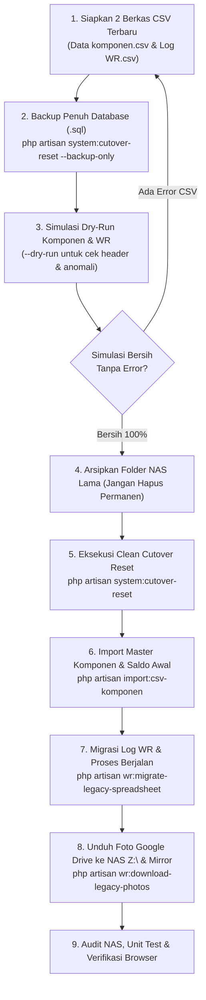

# SOP Resmi Cutover & Rombak Total Database Komponen dan Log WR (Pra-Go-Live)

Dokumen ini adalah **Standar Operasional Prosedur (SOP) Baku** untuk memperbarui total **Master Database Komponen**, **Saldo Stok Awal**, **Foto NAS**, dan **Seluruh Riwayat & Proses Berjalan Work Request (WR)** dari sistem lama ke **HPK Gudang Inhouse (Laravel 10 + MySQL)** sebelum aplikasi dijalankan di lapangan.

> [!CAUTION]
> **LARANGAN MUTLAK:**
> 1. **DILARANG** menghapus atau mengosongkan tabel secara manual lewat SQL mentah (`TRUNCATE`, `DELETE FROM components`, atau `SET FOREIGN_KEY_CHECKS=0` di phpMyAdmin) karena akan memicu kerusakan relasi Foreign Key (*orphan ID* -> Error 500).
> 2. **DILARANG KERAS** menjalankan `php artisan migrate:fresh` atau `php artisan db:wipe` pada database operasional `hpk_gudang`.
> 3. **WAJIB** melakukan backup `.sql` penuh sebelum memulai pembersihan data uji coba.

---

## 1. Diagram Alur Eksekusi Cutover (End-to-End)



---

## 2. Persiapan Berkas & Aturan Data CSV (Wajib Diperiksa Sebelum Mulai)

### A. Lokasi Berkas Resmi
1. **Master Komponen & Saldo Rak:**
   `Data acuan/Form Work Request - Data komponen.csv`
   Header wajib pada baris ke-2 memuat nama kolom berikut (dideteksi dinamis berdasarkan nama header, aman bila urutan/indeks kolom bergeser):
   `Kode Komponen`, `Nama Komponen`, `Gambar Komponen`, `Kode Rak`, `Saldo`, `Saldo Minimum`, `Panjang ( mm )`, `Diameter / Lebar ( mm )`, `Tebal ( mm )`
2. **Riwayat & Tiket Berjalan Work Request:**
   `System WR lama/Spreadsheet/Form Work Request - Log WR.csv`
   Header wajib pada baris ke-2 memuat: `Tanggal Order`, `No WR`, `Kode Komponen`, `Nama Komponen`, `Gambar Komponen`, `Routing`, `Dimensi`, `Qty`, `Dept Pengaju`, `Dept Penerima`, `Deskripsi`, `Status Pengaju`, `Status Penerima`, `Status Barang`, `Data Proses`, dll.

### B. Aturan Anti-Double Counting Stok (Sangat Penting)
* Angka pada kolom **`Saldo`** di `Data komponen.csv` adalah **saldo fisik yang sudah berada di rak gudang saat cutover**.
* Tiket WR yang di `Log WR.csv` masih berstatus **`Siap diambil`** atau **`Menuju Pengaju`** **BELUM** dihitung sebagai masuk gudang oleh sistem. Saat nanti petugas Gudang menekan **`Scan Diterima`** di sistem baru, stok rak akan **otomatis bertambah**.
* **Pastikan:** Barang dari tiket WR yang masih menggantung tersebut **belum** ikut dijumlahkan ke kolom `Saldo` di CSV komponen agar tidak terjadi penghitungan ganda.

### C. Pengamanan Foto NAS (`Z:\`)
* Sebelum menarik ulang foto dari Google Drive, **pindahkan/arsipkan** (bukan hapus permanen) isi folder `Z:\08.Project\04. HPK Digitalisasi Program\04. Gudang-Komponen\Komonpen Gudang In House` ke folder cadangan (misal `_ARCHIVE_PRE_GOLIVE`), karena file CAD `.pdf` atau foto unggahan manual yang tidak memiliki link Google Drive tidak dapat diunduh ulang dari CSV.

---

## 3. Matriks Tabel saat Cutover Reset (`system:cutover-reset`)

Command `php artisan system:cutover-reset` membersihkan tabel transaksi/uji coba secara berurutan (anak → induk) dalam `DB::transaction()` agar integritas Foreign Key tetap 100% valid:

| Kelompok Tabel | Nama Tabel | Perlakuan Saat Cutover |
| :--- | :--- | :--- |
| **Dibersihkan Terurut (Data Uji Coba)** | `work_request_logs`, `work_request_steps`, `work_requests`, `transaction_items`, `transactions`, `qr_requests`, `cycle_count_items`, `cycle_counts`, `disposal_items`, `disposals`, `ecrs`, `stock_balances`, `components`, `activity_log` | **Dihapus bersih** & `AUTO_INCREMENT` direset ke `1` (setelah backup `.sql` sukses diverifikasi). |
| **Dipertahankan Utuh 100% (Konfigurasi Inti)** | `users`, `roles`, `permissions`, `model_has_roles`, `model_has_permissions`, `role_has_permissions`, `departments`, `warehouses`, `zones`, `locations`, `settings`, `component_categories`, `uoms` | **TIDAK DISENTUH.** Akun operator, hak akses RBAC, 15 departemen, denah rak, dan pengaturan sistem tetap utuh. |

---

## 4. Prosedur Langkah-demi-Langkah (*Step-by-Step Runbook*)

### Langkah 1: Buat Backup `.sql` & Uji Simulasi (`--dry-run`)
```bash
# 1. Buat backup penuh database hpk_gudang ke storage/app/backups/
php artisan system:cutover-reset --backup-only

# 2. Simulasi pembacaan CSV Komponen (0 perubahan ke DB)
php artisan import:csv-komponen --dry-run

# 3. Simulasi pembacaan CSV Log WR (0 perubahan ke DB)
php artisan wr:migrate-legacy-spreadsheet --dry-run
```
> Pastikan hasil `--dry-run` tidak melaporkan error header atau baris anomali sebelum lanjut ke Langkah 2.

### Langkah 2: Reset Data Uji Coba + Import Komponen + Migrasi WR
```bash
# 1. Reset data uji coba (otomatis membuat backup .sql tambahan sebelum hapus)
php artisan system:cutover-reset

# 2. Import Master Komponen resmi (otomatis source = 'master' & isi stock_balances)
php artisan import:csv-komponen

# 3. Migrasi seluruh Log WR & tiket in-progress (otomatis source = 'wr_adhoc' untuk part 'Baru',
#    target_location_id terhubung ke rak komponen, dan multi-routing steps terpecah lengkap)
php artisan wr:migrate-legacy-spreadsheet
```

### Langkah 3: Unduh & Sinkronkan Foto ke NAS (`Z:\`) dan Mirror Web
```bash
# Simulasi daftar foto yang akan diunduh
php artisan wr:download-legacy-photos --dry-run

# Eksekusi unduh ke NAS Z:\ dan public/uploads/components/
php artisan wr:download-legacy-photos

# Audit konektivitas dan kelengkapan file foto NAS
php artisan components:check-nas
```

### Langkah 4: Validasi Otomatis & Verifikasi Lapangan
1. Jalankan pengujian terisolasi pada SQLite `:memory:`:
   ```bash
   php artisan test --filter=LegacyWrMigrationTest
   ```
2. Periksa antarmuka web:
   * `/components`: pastikan jumlah part master sesuai CSV, tidak ada part `NEW-%` (`wr_adhoc`) yang bocor ke Master Komponen, serta foto/PDF dari NAS tampil normal.
   * `/work-requests`: cek tiket `Belum Verifikasi`, `Dalam antrian`, `Proses In`, `Siap diambil`, dan `Menuju Pengaju` dapat dilanjutkan aksinya sesuai alur.
   * `/material-handling`: cek tiket `Siap diambil` muncul pada tab penjemputan MH.

---

## 5. Prosedur Pemulihan Darurat (*Emergency Rollback*)

Jika hasil import dirasa belum sesuai atau terjadi kesalahan pada file CSV, kembalikan database ke kondisi persis sebelum cutover menggunakan file `.sql` hasil backup di `storage/app/backups/`:

```powershell
# Contoh perintah restore cepat di Windows PowerShell (sesuaikan nama file backup):
Get-Content "storage\app\backups\hpk_gudang_pre_cutover_YYYYMMDD_HHMMSS.sql" -Raw | & "C:\xampp\mysql\bin\mysql.exe" -u root hpk_gudang
```

Database akan kembali **100% identik** dengan kondisi sebelum cutover dalam hitungan detik.
